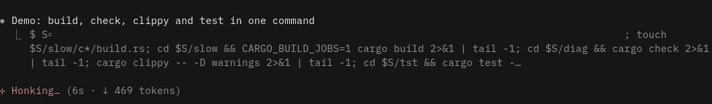

# cargo-progress

A Claude Code mod that shows cargo's progress bar under a running cargo command, instead of a line per crate, and leaves a short result note when the command finishes.



## Install

At the prompt of a Claude Code terminal session:

```
/plugin install cargo-progress --marketplace Celsiusss/cargo-progress-claude-mod
```

Answer `y` to add the marketplace, then pick a scope. From a shell:

```
claude plugin install cargo-progress --marketplace Celsiusss/cargo-progress-claude-mod
```

In the desktop app, where `/plugin` does not run: click + next to the prompt box, then Plugins, Add marketplace with `Celsiusss/cargo-progress-claude-mod`, then Add plugin.

To run it from a local checkout instead:

```
claude --plugin-dir /path/to/cargo-progress-claude-mod
```

## Usage

It works on any cargo command Claude runs through the Bash tool, including piped ones like `cargo test 2>&1 | tail -60`; the notes still count everything. Claude reads cargo's normal output, minus the progress bar's frames, with the same exit code.

## Requirements

- `perl` on the `PATH` (without it, cargo runs as usual and no bar is shown)
- A POSIX shell (bash or zsh)

## How it works

The mod puts a `cargo` shell function in front of the command. The function runs `bin/cargo-progress.pl`, which starts cargo with its bar forced on, passes its output through and records the latest frame and the results in a temporary file. The mod reads that file and draws the bar and the notes. Commands run in the background, and cargo called by path, are left alone.

## License

CC0 1.0, see [LICENSE](LICENSE).
